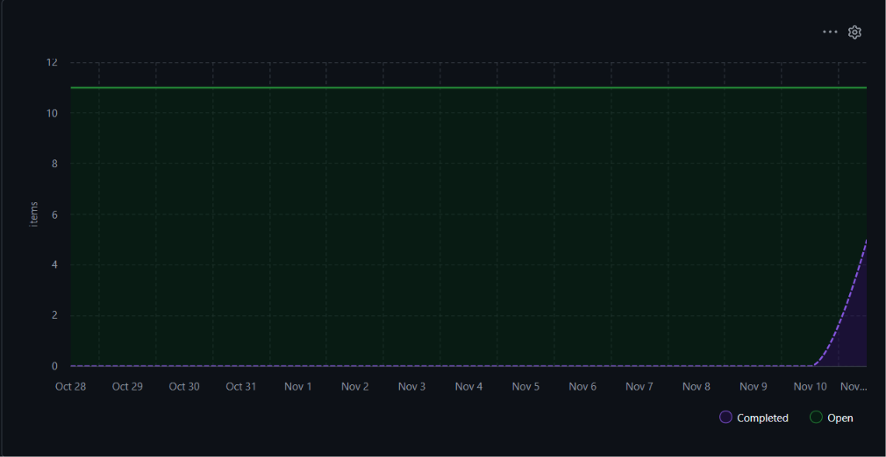

# Informe de Gestión y Productividad - LavaRápido

Fecha de corte: 11 de noviembre de 2026.

## 1. Resumen de las iteraciones

El tablero se organizó al cierre de la entrega. El calendario de tres
iteraciones se registró posteriormente y no constituye evidencia de
seguimiento continuo durante esas fechas.

| Iteración | Periodo registrado |
|---|---|
| Sprint 1 | 1 al 14 de octubre de 2026 |
| Sprint 2 | 15 al 28 de octubre de 2026 |
| Sprint 3 | 29 de octubre al 11 de noviembre de 2026 |

El plan inicial documentó una velocidad estimada de 10 SP por sprint.
No existe evidencia suficiente para determinar la velocidad real de
cada iteración ni su porcentaje de cumplimiento.

El alcance total estimado es de 50 SP. El MVP implementado corresponde
a 30 SP. Las extensiones pendientes suman 20 SP.

## 2. Métricas y seguimiento del avance

| Indicador | Resultado al corte |
|---|---:|
| Historias del backlog | 11 |
| Historias implementadas | 5 |
| Puntos del backlog | 50 SP |
| Puntos implementados | 30 SP |
| Puntos pendientes | 20 SP |
| Alcance estimado implementado | 60 % |
| Pruebas automatizadas aprobadas | 5 |
| Pruebas automatizadas fallidas | 0 |

El 60 % representa la proporción de puntos implementados respecto al
backlog completo. No equivale al cumplimiento de un sprint.

### Gráfico Burn-up

El gráfico muestra cinco historias completadas al corte y utiliza
conteo de historias, no Story Points. Los puntos implementados se
presentan por separado en la tabla de métricas: 30 de 50 SP.

El tablero se actualizó al cierre. Un gráfico generado a partir de estos
registros debe identificarse como registro tardío; no permite reconstruir
el avance diario ni calcular velocidades históricas fiables.

### Análisis de desviaciones

- El código del MVP se incorporó al repositorio mediante un PR conjunto.
  No existe trazabilidad de desarrollo mediante un PR por cada historia.
- El tablero y los estados se organizaron después del desarrollo.
- No hubo revisión independiente registrada en el PR de incorporación.
- Una prueba de concurrencia falló en Windows porque la salida numérica
  incluía códigos de color. Se corrigió convirtiendo el estado a texto.
  Después de la corrección, las cinco pruebas finalizaron correctamente.
- Las historias de extensión permanecen fuera del incremento entregado.

## 3. Incremento entregado y Definition of Done

Para este corte se consideran implementadas las historias incluidas en
el MVP funcional, con código incorporado a main, guía de pruebas manuales
y pruebas automatizadas del MVP aprobadas.

No se afirma que cada criterio tenga una prueba automatizada independiente.

| Issue | Historia | SP | Estado funcional | Evidencia |
|---|---|---:|---|---|
| #1 | HU01 - Registro de lavadero | 5 | Implementada | PR #12 |
| #2 | HU02 - Disponibilidad y capacidad | 5 | Implementada | PR #12 |
| #3 | HU03 - Reserva de turno | 13 | Implementada | PR #12 |
| #4 | HU04 - Confirmación y código | 5 | Implementada | PR #12 |
| #8 | HU08 - Aprobación y supervisión | 2 | Implementada | PR #12 |

PR de incorporación:
https://github.com/juanfernando27/TrabajoIngeniria/pull/12

Guía de comprobación funcional:
[LavaRapido/PRUEBAS_MANUALES.md](../LavaRapido/PRUEBAS_MANUALES.md)

### Alcance pendiente

| Issue | Historia | SP |
|---|---|---:|
| #5 | HU05 - Gestión de turnos del lavadero | 5 |
| #6 | HU06 - Calificación del servicio | 2 |
| #7 | HU07 - Cancelación de reserva | 3 |
| #9 | HU09 - Actualización del estado del lavado | 3 |
| #10 | HU10 - Disputas y reembolsos | 5 |
| #11 | HU11 - Catálogo y actualización de precios | 2 |

HU11 tiene una base parcial de consulta de servicios y precios.
La actualización de precios posterior al registro sigue pendiente.

## 4. Mantenibilidad del código fuente

- Presentación: HTML, CSS y JavaScript en LavaRapido/src/views.
- Lógica de negocio: controladores en LavaRapido/src/controllers.
- Acceso a datos: DAO en LavaRapido/src/dao.
- Entidades: clases en LavaRapido/src/models.
- Fachada: LavaRapidoFacade centraliza las operaciones del MVP.
- Modularización: CommonJS mediante require y module.exports.
- Contratos: documentación JSDoc de entradas, resultados y errores.
- Persistencia: SQLite mediante node:sqlite.
- Consistencia: transacciones y comprobación de capacidad al reservar.
- Verificación: pruebas del MVP, persistencia, reversión de escrituras
  y competencia entre procesos por el último cupo.

SQLite se mantuvo por decisión del proyecto. Es una adaptación respecto
al ejemplo de persistencia simulada en memoria de la guía del laboratorio.

El acceso por roles, los correos y la pasarela de pagos son simulados.
El prototipo no implementa autenticación real.

### Equipo y evidencia de participación

El documento de estimación define estos roles:

| Integrante | Rol definido |
|---|---|
| Juan Fernando Urbano | Desarrollador |
| Cristian Camilo Lucero | Product Owner |
| Andrés Muñoz | Líder Técnico |

La incorporación y la validación descritas en este informe fueron
realizadas por Juan Fernando Urbano. El PR #12 no cuenta con revisión
independiente de otro integrante. Los roles definidos no se presentan
como evidencia de contribuciones que no estén registradas.

## 5. Reajustes y recomendaciones para una siguiente iteración

La entrega académica termina en la fecha de corte. No se presenta
una nueva iteración como compromiso ya ejecutado.

Para una continuación se recomienda:

- Seleccionar un alcance según la capacidad real disponible.
- Crear ramas por Issue antes de modificar el código.
- Vincular los PR con sus Issues mediante Closes #N cuando corresponda.
- Registrar el avance durante la iteración.
- Obtener revisión independiente cuando sea posible.
- Calcular la velocidad solo con historias terminadas dentro del periodo.
- Completar las extensiones según su prioridad y dependencias.

No se modifica retrospectivamente la estimación inicial para aparentar
un porcentaje de cumplimiento.